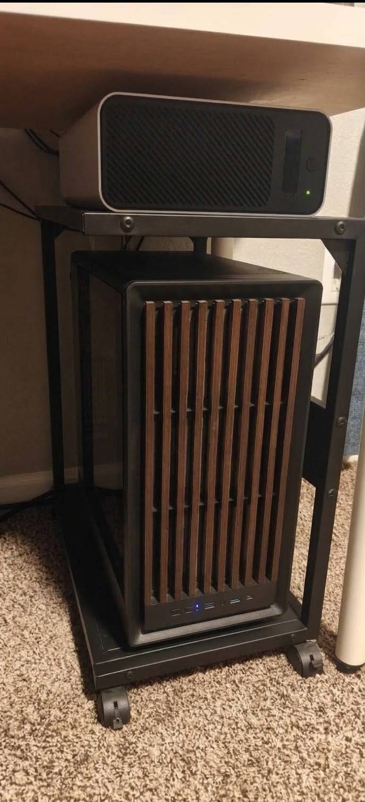
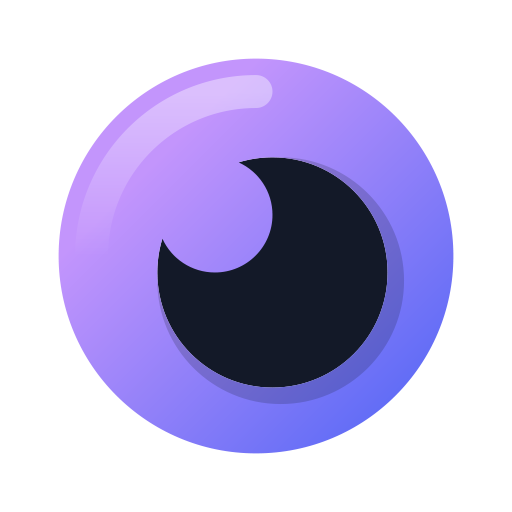
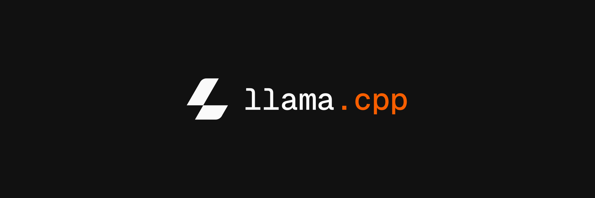

# Homelab

## Hardware

| Component | Spec |
| --- | --- |
| CPU | AMD Ryzen 7 5700 (8C/16T desktop) |
| RAM | 64 GB DDR4 (Corsair Vengeance) |
| GPU | 2× NVIDIA GeForce RTX 3060 12 GB GDDR6 (24 GB VRAM total) |
| Storage | 3× 1 TB SSD + 2× 8 TB WD Red Pro HDD (media library) |
| Motherboard | ASRock X470 Master SLI |
| PSU | MSI MAG A1000GL PCIe5 — fully modular 1000 W, 80+ Gold |
| UPS | Goldenmate 1000 VA / 800 W lithium battery backup & surge protector |
| Network | Ubiquiti Cloud Gateway Ultra (UCG-Ultra) |

The dual GPUs run local LLM inference ([llama.cpp](./services/llamacpp)); everything else runs in Docker. The UPS rides out short power blips, and the UCG-Ultra routes the whole home network.

## Services

Some of the services running on the homelab, with a brief description of what each is used for.

| Service | Description | Link |
| --- | --- | --- |
|  **Homepage** | Self-hosted start page that links to every homelab service with live status widgets (Docker, Jellyfin, etc.). The default landing page for the lab. | [Docs](./services/homepage.md) |
|  **Nginx Proxy Manager** | Reverse proxy and single entry point for all HTTP(S) traffic; manages hostnames and issues/renews Let's Encrypt certificates automatically. | [Docs](./services/nginx-proxy-manager.md) |
|  **Cloudflare DDNS** | Background daemon that keeps the Cloudflare A records pointing at the home connection's current public IP, so public subdomains keep working when the ISP changes it. | [Docs](./services/cloudflare-ddns.md) |
|  **Nextcloud** | Private cloud for file storage and sharing, calendar, and contacts (app + MariaDB). | [Docs](./services/nextcloud.md) |
|  **Seerr** | Movie & series request manager: browse catalogs, request titles, with Discord notifications when the media lands in the library. | [Docs](./services/seerr.md) |
|  **n8n** | Workflow automation for connecting apps and APIs. Runs scheduled jobs powered by locally hosted LLMs — a daily local-AI digest and a curated morning briefing, both posted to Discord via webhook. | [Docs](./services/n8n.md) |
|  **Open WebUI** | Chat interface for local LLMs; pointed at llama.cpp running natively on the host so all inference stays on the network. | [Docs](./services/openwebui.md) |
|  **Home Assistant** | Home automation hub: smart device integrations, automations, scenes, and dashboards (runs privileged for hardware access). | [Docs](./services/home-assistant.md) |
|  **Uptime Kuma** | Uptime monitoring: checks that homelab services and external sites stay up, tracks response times, and sends alerts on outages. | [Docs](./services/uptime-kuma.md) |
|  **Megan's Library** | My wife's online book tracker for her personal library — she has cataloged **600+ books** so far and is working toward a goal of **1,000**. Built with React, Express & PostgreSQL. | [Docs](./services/megans-library.md) |
|  **tools.nevswrld** | My internal tool utility kit: media downloader (yt-dlp → MP4/MP3) and file converter (ffmpeg), built on Vue 3 + FastAPI. | [Docs](./services/tools-nevswrld.md) |
|  **Jellyfin** | The media server — streams movies and TV from the local library (2× 8 TB WD Red Pro) to any device, wired into Seerr for requests. | [Docs](./services/jellyfin.md) |
|  **llama.cpp** | Local LLM inference running natively on the host — serves an OpenAI-compatible API used by Open WebUI, n8n and OpenCode. Runs Qwen3.8 27B and Ornith 1.5 35b A3B across two RTX 3060s. | [Docs](./services/llamacpp.md) |
