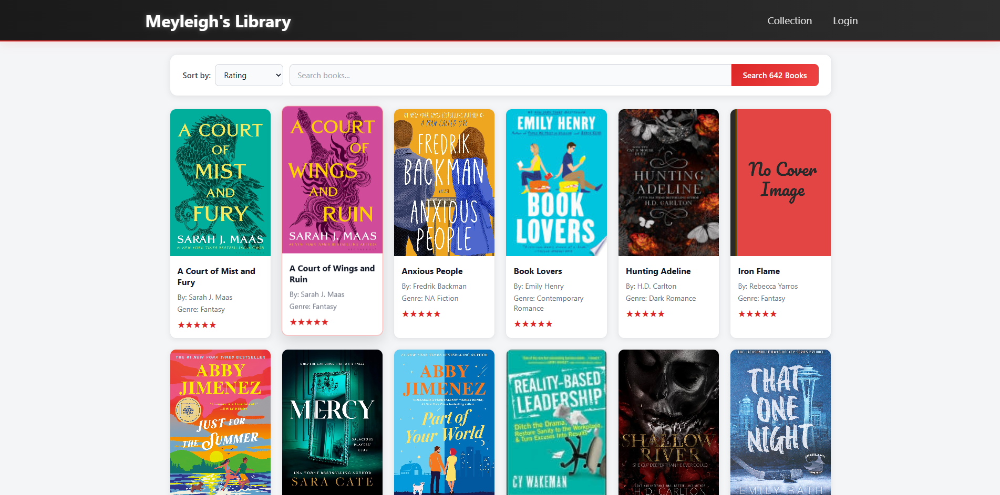

# Megan's Library

| Landing page | Collection view |
| --- | --- |
|  |  |

My wife's online book tracker for her personal library — she has cataloged **600+ books** so far and is working toward a goal of **1,000**. Track the collection with covers, ratings, summaries, and reviews; search, sort (including most-recent), and an A-Z index across the catalog.

## Stack

| Layer | Tech |
| --- | --- |
| Frontend | React (Vite) |
| Backend | Node.js / Express REST API |
| Database | PostgreSQL 16 (migrated from MySQL) |
| Infra | Docker Compose, three services |

- Book cover images are fetched/updated via helper scripts in the repo (Puppeteer-based).
