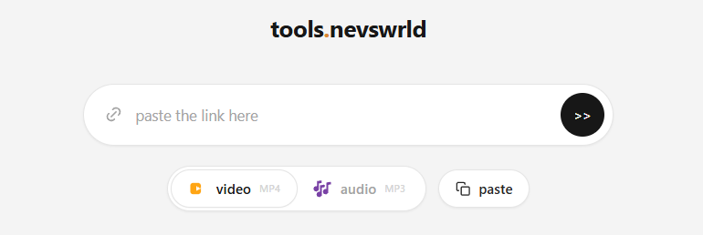
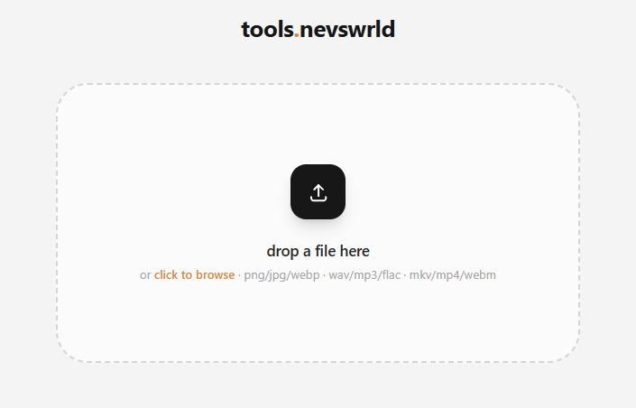

# tools.nevswrld

My internal tool utility kit — a self-hosted dashboard with a cobalt.tools-inspired light theme. Currently ships two tools:

- **Media Downloader** — paste a URL, download video (MP4) or audio (MP3) via `yt-dlp` with live progress/speed/ETA.
- **File Converter** — drag & drop a file and convert between image/audio/video formats via `ffmpeg`.

| Media Downloader | File Converter |
| --- | --- |
|  |  |

## Stack

| Layer | Tech |
| --- | --- |
| Frontend | Vue 3 + Vite + Tailwind CSS, served by nginx |
| Backend | Python 3.12 + FastAPI (uvicorn) |
| Media | `yt-dlp` (downloads), `ffmpeg` (conversions) |
| Infra | Docker Compose, two services |

## Deployment

| Service | Port | Notes |
| --- | --- | --- |
| `frontend` | `3100` | nginx serves the SPA and proxies `/api/*` + `/files/*` to the backend |
| `backend` | — (internal `8000`) | Exposed only on the compose network; API docs at `/api/docs` |

- Downloaded files persist in a bind-mounted `./downloads` directory; conversions in `./conversions`.
- Uploads are streamed to disk (no RAM buffering) with a 2 GiB cap.
- The app is plugin-based: new tools register themselves in the backend router registry and frontend tool list, and the sidebar/routes pick them up automatically.